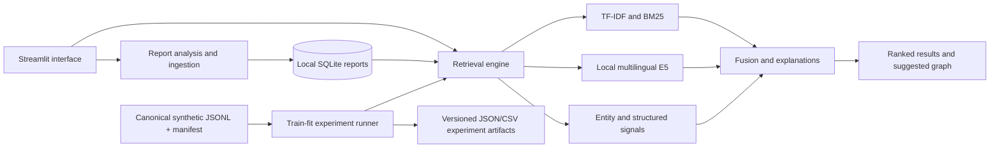

> Phase 2 portability (5 November 2026): paths.py resolves configurable models/cache/database/dataset/results/logs/exports/temp against project root; no application logic depends on a username or current directory. runtime.py rotates local logs and writes unique exports. Separate setup/start scripts recreate moved virtual environments safely. Shared policy-specific encoder wrappers reuse one neural model per active device/identity; bounded RAM/disk caches and batched deduplication reduce rerun work. SQLite views are cached by database/WAL modification signature. See docs/WINDOWS_SETUP_AND_PORTABILITY.md and docs/PHASE2_VERIFICATION.md.

# Technical architecture

SHERLOCKED is a local Python/Streamlit research application. It uses one process for the interface and Python services; it has no microservices, paid AI APIs or remote inference dependency. Run it from the existing project directory using the Windows launcher described in README.

## Component boundaries

| Module | Responsibility |
|---|---|
| `app.py` / `sherlocked/ui.py` | Thin entrypoint and seven-workspace shell, session queries, service adapters, exports and navigation |
| `sherlocked/design.py` / `assets/interface/sherlocked.css` | CASE FILE NOIR presentation primitives, offline branding, source documents and chart themes |
| `dataset.py` | Original deterministic 90-report fixtures and manifest; preserved generator |
| `ingestion.py` | Validate records and exports without silently changing source text |
| `storage.py` | Local SQLite initialization, transactional import and immutable report records |
| `signals.py` | Script identification, explicit-mention extraction, source provenance, entity/metadata comparison |
| `retrieval.py` | Preserved word TF-IDF index and original-source term spans |
| `engine.py` | BM25, independent method selection, weighted fusion, RRF and optional consistency reranking |
| `semantic.py` | Pinned local encoder, explicit setup, device selection, vector caches and sentence evidence |
| `experiments.py` | Family-isolated comparisons, ablations, metric slices, family bootstrap and artifact export |
| `evaluate.py` | Historical first-increment TF-IDF protocol retained for reproducibility |
| `settings.py` | Validated non-secret local preferences |
| `visualization.py` | Suggested report relationship graph |

## Data ownership and persistence

`data/reports.jsonl` and `data/manifest.json` remain the canonical synthetic benchmark. SQLite `data/sherlocked.sqlite3` holds browsable initialized fixtures and additional fictional submissions. Store initialization is idempotent: existing report text is never replaced. Imports validate all rows and split assignments, then insert transactionally; duplicate IDs/narratives and cross-partition scenario families are rejected. SQLite access uses short-lived connections with transaction contexts and parameterized queries. This is a prototype store, not evidence custody or a secure multi-user database.

Each original narrative has a stable report ID and source ID. Derived tokens and mentions retain original character offsets. Report metadata records whether a value came from a source rule or supplied annotation. Scenario-family labels, generation variant labels and train/dev/test assignments are used for validation/evaluation and never become retrieval features. User reports without experimental labels remain outside benchmark experiments unless explicitly incorporated into a versioned dataset.

## Index lifecycle and split discipline

The interactive application can explore the stored report corpus. Research evaluation separately fits vocabulary, TF-IDF document frequencies and BM25 document statistics on train records only, then retrieves candidates within the selected held-out partition. The query excludes itself. Do not compare demo scores fitted on a larger corpus with frozen train-fit benchmark scores without stating the difference.

The index service accepts report dictionaries, candidate dictionaries, method, K, exclusions and weights, and returns report objects with scores, components, explanation and advisory status. A future FastAPI adapter can expose this service without moving ranking logic into frontend code. There is no current REST API, external authentication service or entity-merging operation.

## Semantic setup and cache lifecycle

The audited encoder configuration is versioned in `configs/model.json`. `scripts/setup_model.py` explicitly downloads the immutable model revision into `models/multilingual-e5-small`. The app does not trigger a large download merely by importing a module. Local availability and dependency/device failures are visible, and users choose keyword baselines explicitly if necessary.

Cache keys include exact text, model ID/revision, input role prefix and maximum token length. Query and passage vectors are separate. Device is intentionally excluded from cache identity: a normalized embedding represents the same pinned mathematical model on CPU/CUDA, with normal floating-point tolerance; cache reuse is not a device benchmark. A dedicated smoke script bypasses cache to verify actual execution on both devices. Cache reads reject invalid shapes/nonfinite or nonunit vectors; writes use unique temporary files followed by atomic replacement to prevent concurrent-session file collisions. A per-encoder lock protects lazy model loading and inference. Cached vectors use NumPy with pickle disabled.

E5 processes at most 512 tokens including its prefix and special tokens. Original text stays intact. Semantic explanations report actual token counts, truncation status and retained source character coverage when the fast tokenizer provides offsets. Sentence evidence is separately scored and may include a sentence beyond the report-level window; the interface must not treat that as causal report attribution. No unsupported alternative encoder is accepted through the audited E5 interface without reviewing its dimensions, prefixes, pooling and license.

## Ranking and explanation contract

The engine returns raw component scores separately from normalized scores and fusion contributions. Weighted fusion renormalizes observed positive-weight signals; missing metadata does not become a match or mismatch. BM25 has a query-pool-dependent normalization for weighted fusion. RRF has a configurable nonnegative rank constant, default 60, and skips absent/nonpositive signal rankings. Stable report-ID tie-breaking makes zero-score results reproducible. Optional reranking applies an explicit contradiction-count penalty to a shortlist, not a neural cross-encoder.

Lexical evidence contains original term spans and numerical contributions. Entity evidence distinguishes exact/normalized/approximate/possible/unknown comparisons without merging records. Structured explanations expose observed matching and differing fields, their provenance and missingness. Semantic evidence contains an actual source sentence pair and measured cosine. Every edge in the graph represents a suggested report connection and includes method/evidence rather than an asserted factual relationship.

## Failure behavior and checks

Empty text yields no retrieval results, even if a metadata dictionary was supplied. Invalid training corpora, duplicate candidate IDs, invalid K/weights/BM25/RRF parameters and unreviewed model configurations fail clearly. A semantic request never becomes a lexical result silently. Torch/CUDA are imported only when needed for semantic setup/inference, so lexical methods remain available when model dependencies fail.

Unit tests cover lexical mathematics, source spans, missingness, settings, imports/storage, metrics, fusion and cache corruption/role isolation. Streamlit tests cover interface execution. Server health checks establish local startup; browser review is a separate verification step recorded in STATUS. The real semantic smoke artifact records CPU and CUDA inference separately from retrieval experiment accuracy. Saved experiments record dependency versions, dataset/code hashes, configuration, split, ranking details and export paths.

## Scope limits

No enterprise access control, real investigative record support, chain of custody, OSINT collection, surveillance, autonomous investigation, guilt prediction or case management is implemented. Future platform modules remain documentation-only. The local application and synthetic benchmark are a research demonstration, not an operational deployment.
