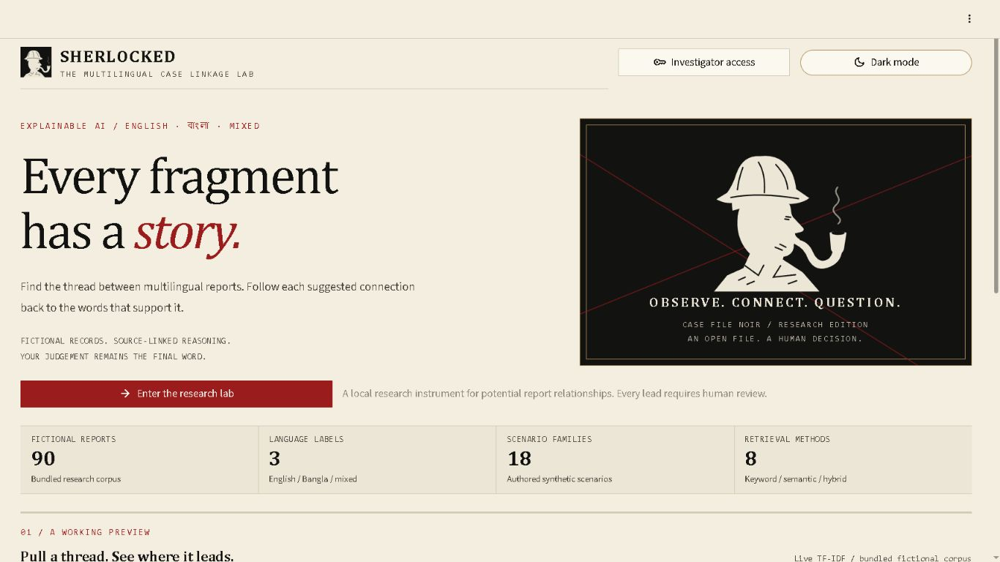
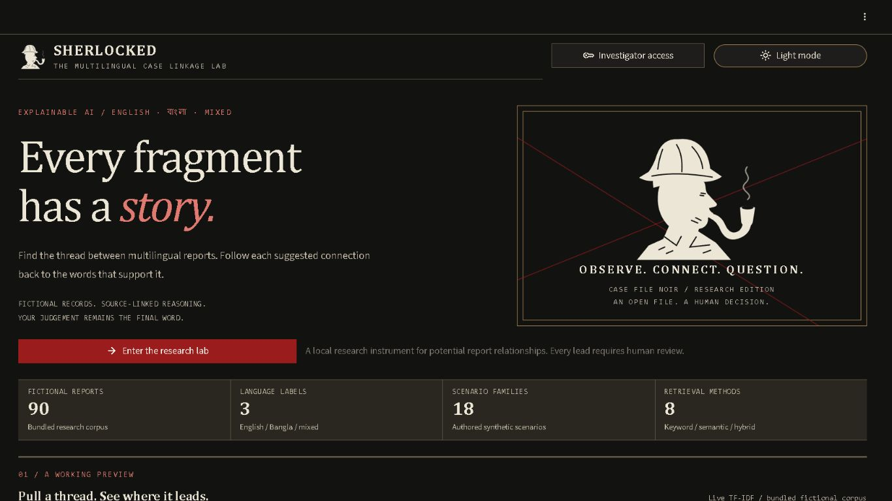
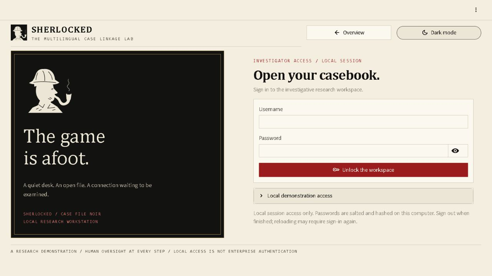
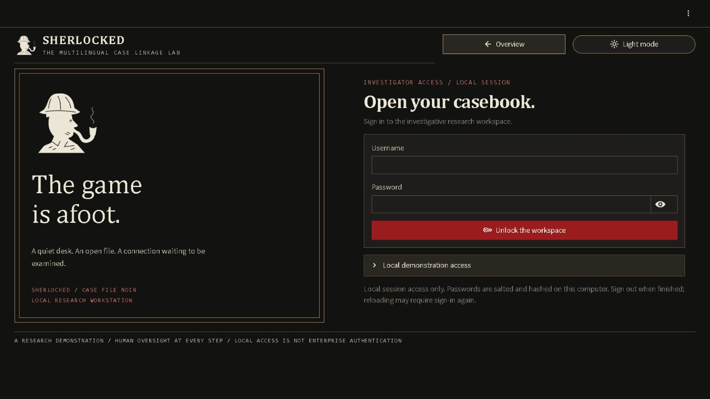
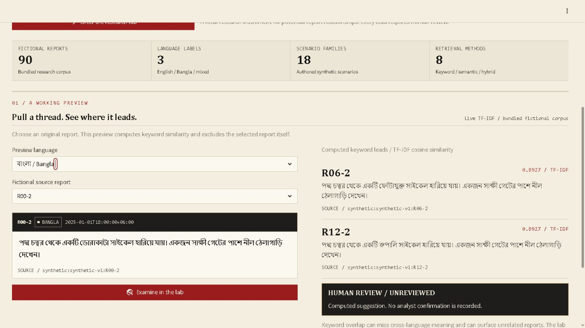
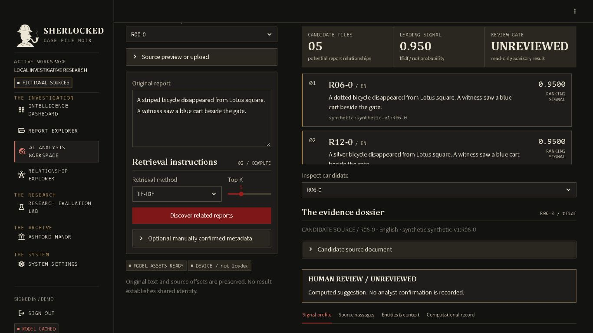
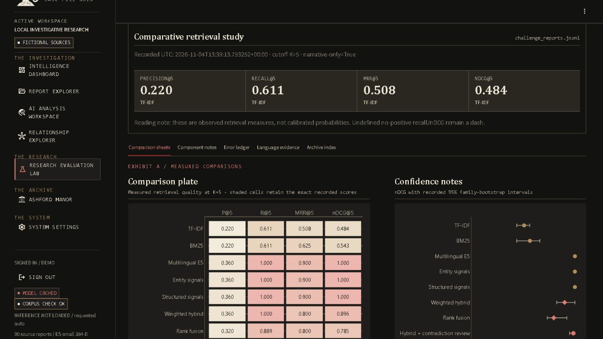
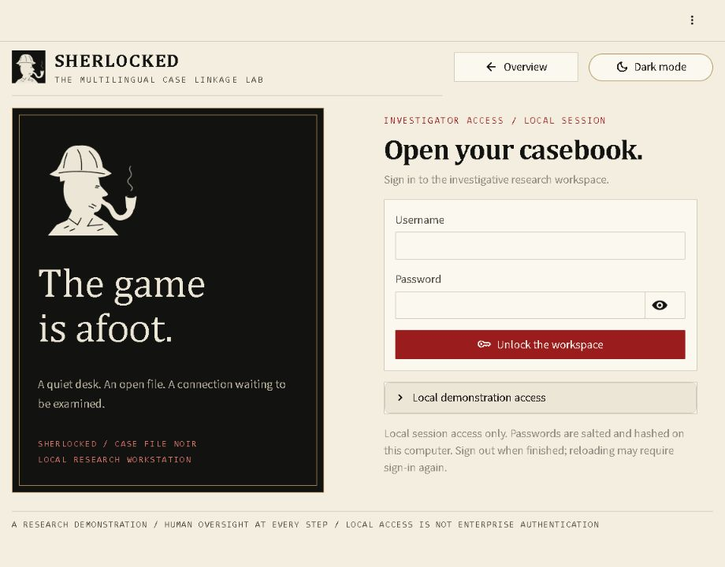
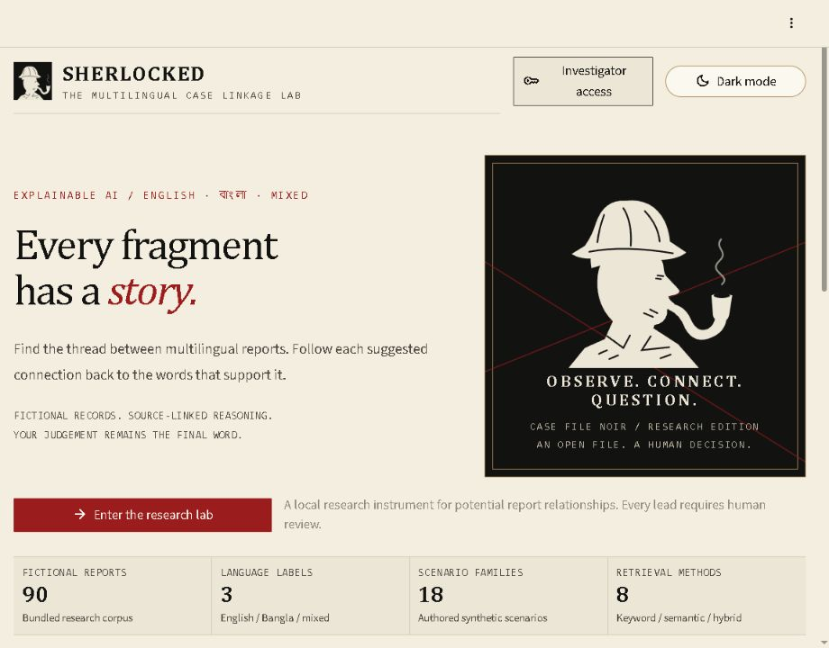

# Landing, local access and dual-theme verification
13 November 2026. Current installation: `C:\Users\NOYON\Documents\ChatGPT\SHERLOCKED`.

## Current revision — clean landing

The user requested removal of the working public preview. The corrected landing is a branded entry screen with login/theme controls and a static capability overview. Report selectors, live TF-IDF results and the landing-to-analysis source handoff are removed. Source preview, upload and retrieval remain available after sign-in inside AI Analysis Workspace.

**Current corrected-build checks:** the integrated local suite passed **91 tests** after preview removal. Actual browser reload confirmed the paper landing runs from hero to corpus statistics, static capability overview and footer, without report selectors, computed results or a working preview. The execution record is [NO_PREVIEW_CHANGE.md](NO_PREVIEW_CHANGE.md), with test output at `logs/no-preview-tests.txt`.

This current capture verifies the cleaned paper landing. Older preview-enabled captures below remain historical; they are not substituted for new evidence of the corrected layout. Corrected source-package checksums/extraction evidence are recorded alongside the rebuilt archive.

The corrected source release target is `dist/CASE-FILE-NOIR-20261113/no-preview/SHERLOCKED-PORTABLE.zip`. It reuses `dist/CASE-FILE-NOIR-20261113/final/SHERLOCKED-MODEL-ASSETS.zip`. Final execution/release evidence must identify the corrected source package rather than reuse a prior source hash.

## Historical evidence — previous preview-enabled entry

All observations, numeric checks and screenshots in this section describe the earlier build. They are retained as history and are **not** validation of the cleaned landing. In particular, images showing a working preview no longer depict the current landing design. No benchmark rerun is implied by retaining these earlier observations.

### Earlier implemented build
Welcome and sign-in use original detective artwork, archival typography, ink/paper surfaces, brass rules and restrained red thread motifs. Edit `sherlocked/ui_entry.py`, `assets/interface/sherlocked.css` and `sherlocked/design.py`. No screenshot or actor likeness was pasted into the UI.

The earlier landing preview computed TF-IDF over the 90 bundled fictional reports, with source IDs, language/source selectors and self-exclusion. Its former Examine in the lab action carried a source through login. Those public-preview features were removed in the current correction. Eight retrieval methods remain inside the authenticated lab.

Local session login, invalid-login feedback, password reveal and sign-out work. The separate access database contains salted PBKDF2-SHA256 hashes and a basic persistent throttle; it does not replace the report database. The demonstration credential is deliberately public: **demo / sherlocked-demo**. No remembered login or enterprise security is claimed. See [local access](LOCAL_ACCESS.md).

Light mode / Dark mode is a labelled native button with a sun/moon icon and brass outline. Session state and `?theme=light` or `?theme=dark` preserve appearance across entry, login, research modules and a URL reload. Authentication remains session-only. Chart themes change presentation without changing ranking values, source text or evidence offsets. Paper dataframe/heatmap inserts and the ink relationship board remain intentional surfaces.

### Earlier observed checks
- Integrated local suite: **91 tests passed**. Includes the authenticated seven-module workflow, English/Bangla/mixed queries, failed/successful login, gate protection, sign-out, theme continuity, preview recomputation/source handoff, salted storage, throttling, source/value preservation, contrast and portable manifests.
- Both palettes' text, muted text and accent roles pass **4.5:1** against background, surface and raised colors. Native input frames, password reveal, sidebar labels and slider values were additionally reviewed/fixed. This is not a complete accessibility certification.
- The real Windows launcher served `http://127.0.0.1:8501/` without dependency installation or model download.
- Browser review: landing/login in both modes, incorrect login denied with generic feedback, correct demo login entered the workspace, dark dashboard/research/TF-IDF analysis rendered, changing theme preserved completed rankings, sign-out returned to landing.
- English R00-0 preview produced R06-0/R12-0 at approximately **0.9500**; Bangla R00-2 produced R06-2/R12-2 at approximately **0.8927**. These are observed lexical scores, not accuracy or relationship probabilities.
- Reviewed 1366 x 768, 1280 x 720 and 920 x 720 layouts. At 920 px landing/login fit the viewport; measured document scroll width was **920 px**. Temporary viewport overrides were reset.
- Initial connection logged transient Streamlit reconnect messages; subsequent tested interactions completed. No claim of an empty console log is made for this session.
- All **51 pre-existing protected file hashes** remained unchanged. Evidence: `logs/entry-preservation.json`. Presentation backup: `backups/entry-theme-before-20261113.zip`.
- Separate source/model archive merge is tested. Actual final source extraction and interpreter checks are recorded externally in `RELEASE_VERIFICATION.json` to avoid self-referential archive hashes.

### Historical screenshots — preview-enabled build

### Earlier scope notes
The requested local entry experience is implemented. Enterprise identity, account recovery, multi-user authorization, remembered sessions, persistent human-review decisions and deferred investigative-platform modules remain outside this increment. Small synthetic data, heuristic extraction and uncalibrated similarity remain limitations. No benchmark was rerun or improved for display purposes.

Portable validation uses the existing interpreter on this computer. Fresh dependency installation on a second physical PC is not certified. First setup needs internet or a suitable trusted wheelhouse; the source/model ZIPs do not contain an installed Python environment. See [release instructions](NOIR_PORTABLE_RELEASE.md).
