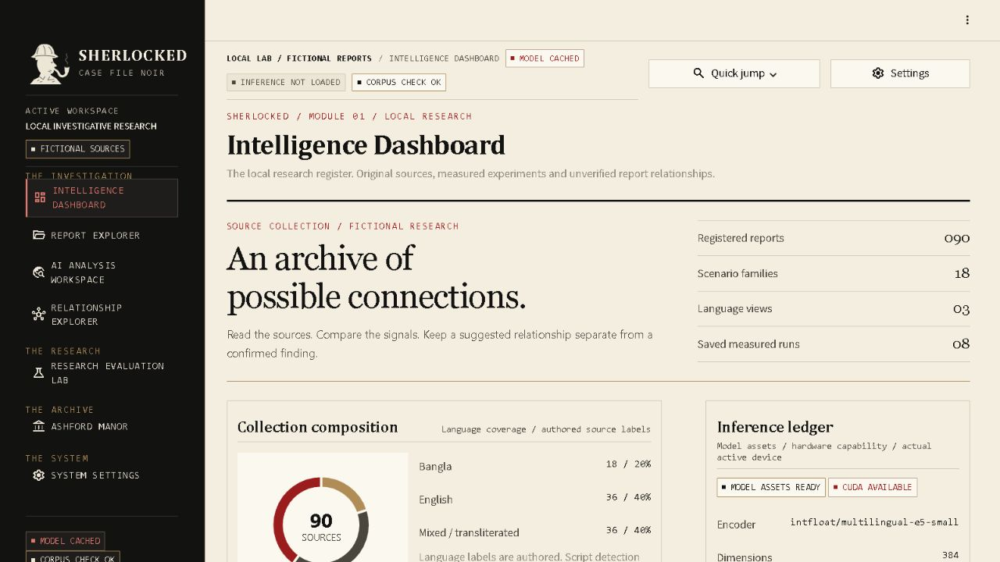
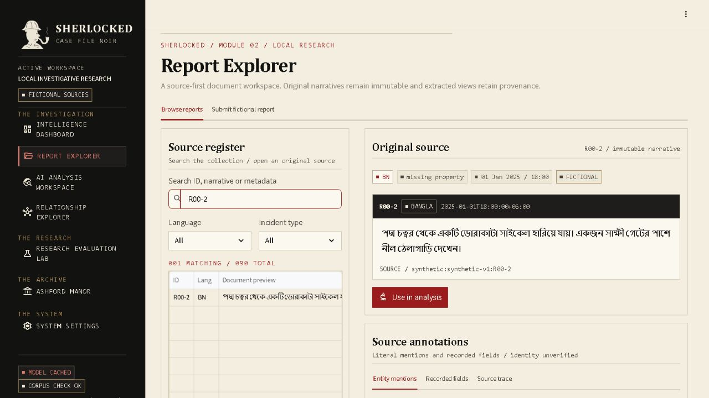
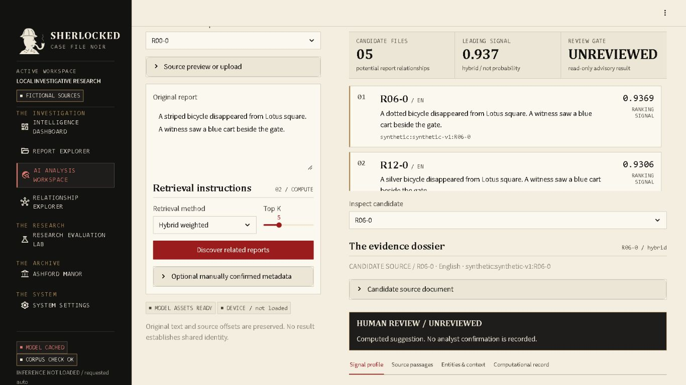
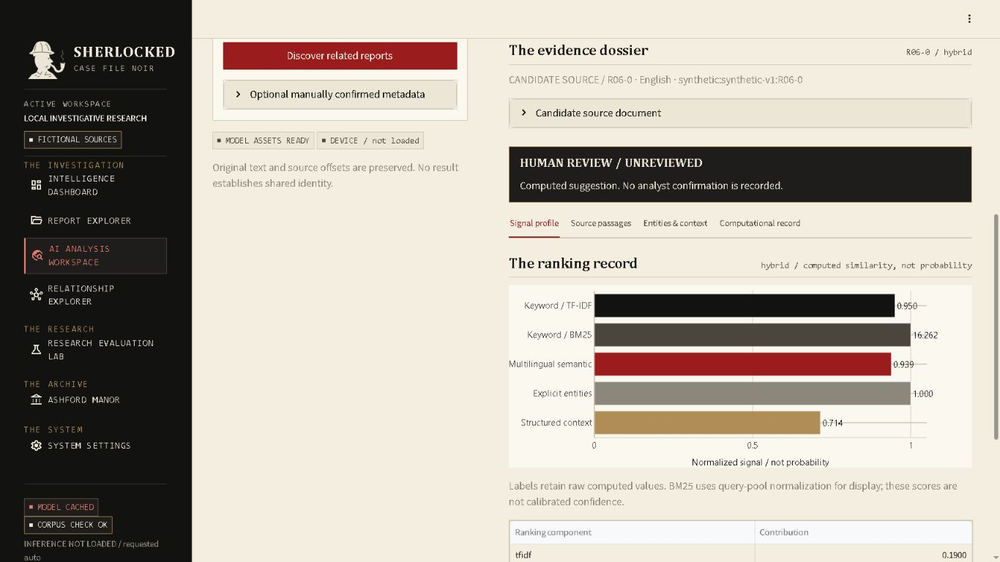
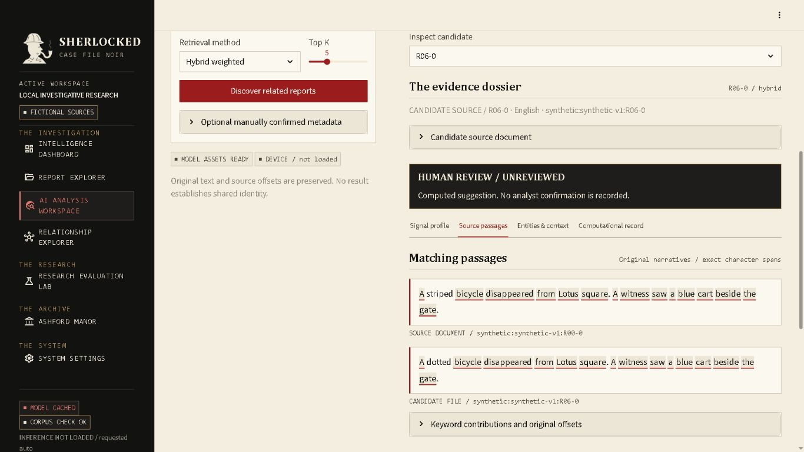
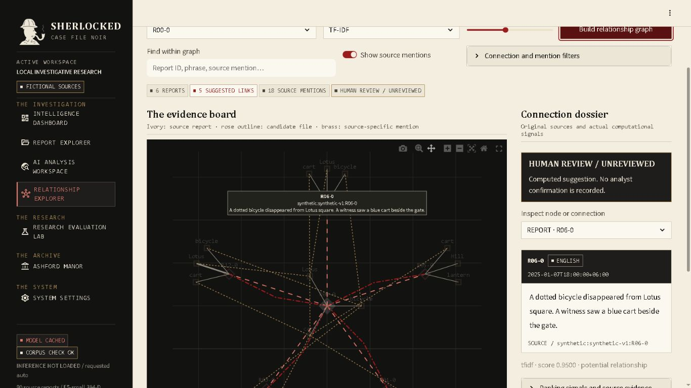
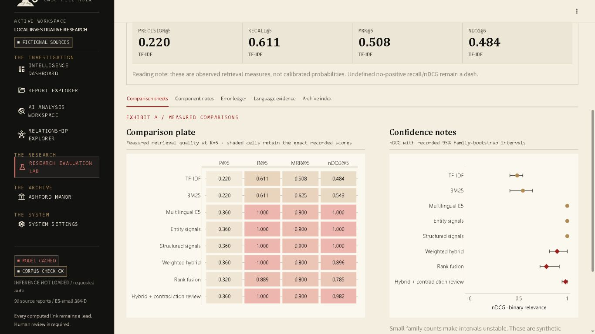
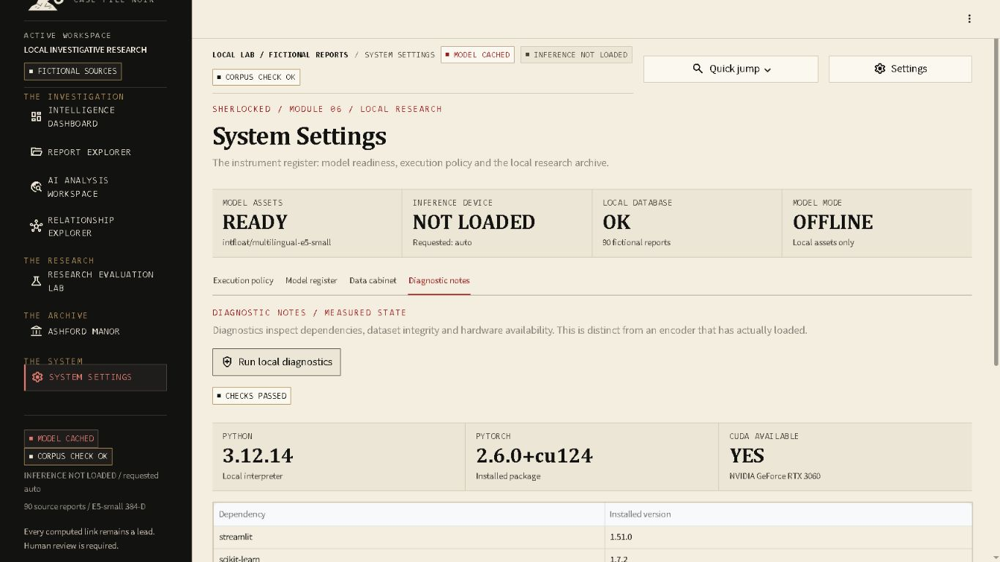
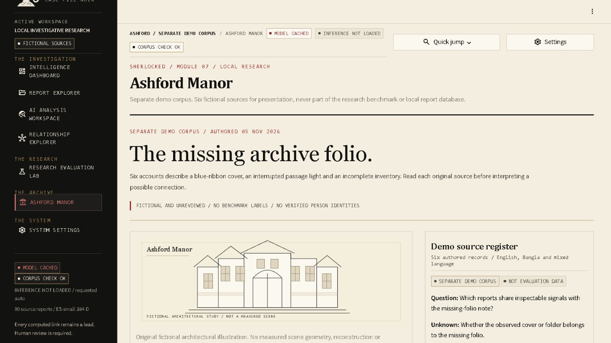
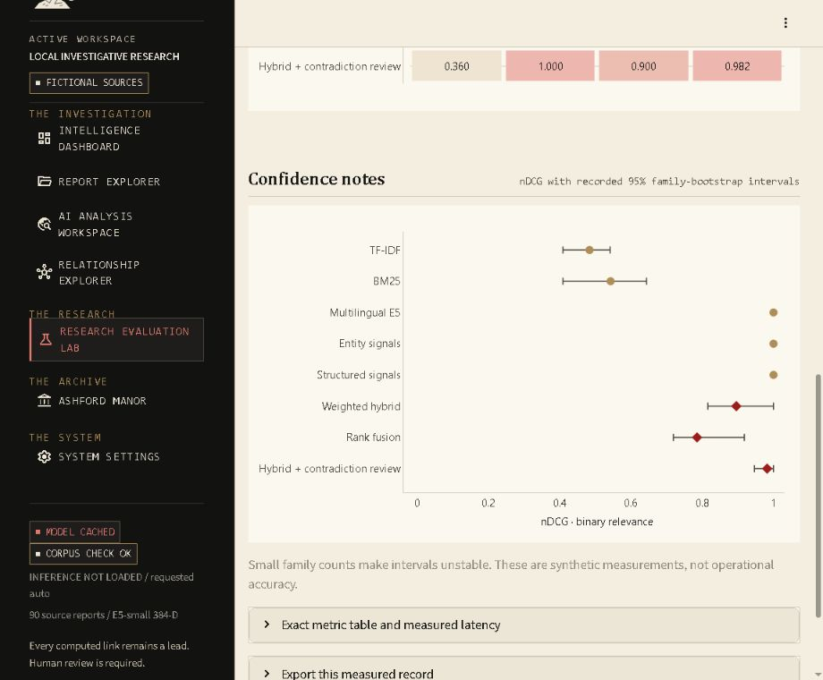

# CASE FILE NOIR — engineering and verification record

Latest correction: [the working preview was removed from the landing](NO_PREVIEW_CHANGE.md). Earlier preview references and captures describe the previous revision.

13 November 2026. Work was applied in the existing project at `C:\Users\NOYON\Documents\ChatGPT\SHERLOCKED`. No `C:\SHERLOCKED` installation or project migration was created. The earlier November 5 design and QA records remain historical.

See [entry-screen and theme verification](ENTRY_VERIFICATION.md) for the latest increment and screenshots.

## What changed

The seven existing workspaces now share an ink navigation rail, paper source dossiers, serif headings, rectangular controls, archival labels and restrained oxblood/rose/brass analytical marks. The original SVG logo family includes a deerstalker, side profile and a curved pipe at the mouth. It uses no actor likeness, remote font, external image service or copied reference artwork.

Analysis uses ranked source cards, raw-versus-normalized signal plots, original matching passages, traceable offsets and an explicit UNREVIEWED gate. The graph distinguishes source-specific mentions, computed report suggestions, mention comparisons and actual recorded differences. Endpoint selection now identifies the corresponding node; edge midpoints identify connections. The Dashboard's activity ordering and choice of the newest result were corrected.

Research and settings retain real measurements and configuration controls. Saved source documents can be located after transfer only when the relocated dataset bytes match the artifact's recorded SHA-256. Historical paths and artifacts are not rewritten. Ashford remains a labelled SEPARATE DEMO CORPUS with its original six narratives unchanged.

Windows setup now selects and verifies the exact requested CPU/CUDA PyTorch variant. The distribution allowlist excludes generated proposal work, caches and private material. No dependencies were reinstalled and no model assets were downloaded during this work.

## File map

| Files | Change |
|---|---|
| `assets/branding/*.svg`, branding README | Original primary, compact, monochrome, ivory, forensic-red and favicon family |
| `assets/interface/sherlocked.css`, `.streamlit/config.toml` | Shared offline NOIR tokens, native widget styling, serif/system fonts and responsive rules |
| `sherlocked/design.py`, `sherlocked/ui.py` | Escaped reusable evidence components, shared charts, logo loader and application shell |
| `sherlocked/ui_data.py`, `ui_analysis.py`, `evidence_ui.py` | Archive, source, candidate and evidence presentation |
| `sherlocked/visualization.py`, `ui_relationships.py` | Evidence-board presentation and reliable node/edge selection |
| `sherlocked/ui_research.py`, `ui_ashford.py`, manor SVG | Measured research, settings and separate demo presentation |
| `setup.ps1`, `scripts/build_distribution.py` | Exact CPU/CUDA profile handling and clean release packaging |
| Presentation, startup and distribution tests | Source preservation, selection, contrast, assets, portability and setup regression checks |
| README, user/architecture guides and current NOIR documents | Current launch, design, release and verification instructions |

The algorithms in engine/retrieval/semantic/signals/experiments, storage/path/settings/runtime services, analytical configuration values and dependency specifications were preserved.

## Checks performed on the current PC

- **91 tests passed** in the integrated local suite after adding landing, login, dual-theme, authentication and manifest-merge checks. The baseline before editing was 66 passing tests. The suite covers all seven screens, English/Bangla/mixed queries, ranking/evidence contracts, original Unicode spans, HTML escaping, missing/failed measurements, graph node/midpoint selection, source relocation with hash refusal, CPU/CUDA setup arguments and distribution exclusions.
- `pip check`: **No broken requirements found**. Windows setup/start scripts parsed successfully. `start.ps1 -Check` passed without installing anything or starting another server.
- The real launcher started the application at **http://127.0.0.1:8501/**. The current installation and START_SHERLOCKED.bat workflow remain in place.
- Real uncached **CPU and CUDA inference passed** using the existing pinned E5 model with offline environment flags enabled. Each run produced four finite, normalized 384-dimensional vectors; related Bangla text outranked the unrelated smoke-test sentence. This was a device smoke check, not a benchmark or latency claim.
- **51 protected file hashes remained unchanged**, including the database, data/qrels/manifests, model files, retrieval/evaluation/backend modules, analytical configurations and historical results. Additional comparisons confirmed unchanged Ashford JSON, dependency specifications and original START/start scripts. Backup: `backups/noir-before-20261113T062008Z.zip`; preservation evidence: `logs/noir-preservation.json`.
- Ten primary normal-text color pairs meet **4.5:1 contrast**. Browser checks separately caught and fixed native heading precedence, sidebar badges, form-submit label contrast and rounded native panels. This is not a complete accessibility certification.

The runtime reports Python 3.12.14, Streamlit 1.51.0, Plotly 6.4.0 and Torch 2.6.0+cu124 on an RTX 3060. Its OS metadata reports Windows 10 build 19044. No Windows 11 or second-physical-computer certification is claimed.

## Actual browser review

All seven modules were inspected in the running local application. Review used 1366 x 768, 1280 x 720 and a narrower 920-pixel window; temporary viewport overrides were reset. At 920 px the research plots stack at about 617 px each, and the document register has no page-level horizontal overflow. Tables retain their own native scrolling. Body text remains 14 px or larger; compact technical labels use their documented smaller sizes.

| Workspace | Observed result |
|---|---|
| Dashboard | Real 90 sources, 18 families, three language views and eight saved runs; actual composition, model availability, session notes and relationship register. Quick jump returned to this page successfully. |
| Report Explorer | Searching R00-2 reduced the index to one source. Original Bangla text, source reference, annotations and the analysis handoff remained available. |
| Analysis | Actual weighted hybrid on R00-0 returned five candidates; leading R06-0 raw ranking score was approximately 0.9369. Source passages retained the striped/dotted distinction and exact source offsets. The actual most-similar sentence pair had cosine approximately 0.9179. An evidence JSON export created a unique local export file. These are workflow observations, not accuracy claims. |
| Relationship Board | Built six report nodes, five suggestions and eighteen literal source mentions. Accessible selection of the R06-0 graph report opened its own source dossier. Edge inspection opened actual source spans. No investigative relationship was marked verified. |
| Research Lab | Recorded comparison sheets, interval chart, error ledger, language evidence and archive index rendered. No new benchmark was run or tuned to improve the display. |
| System Settings | Existing parameters rendered without saving changes. Diagnostic notes reported CHECKS PASSED, installed versions and RTX 3060 CUDA availability. Availability remains distinct from active encoder inference. |
| Ashford Manor | Original illustrative plan, source register and authored timeline rendered. Real TF-IDF comparison over only the six demo reports produced four suggestions with source evidence and recorded differences. |

No browser console errors were observed in the earlier seven-workspace QA session. The later entry-screen session recorded transient Streamlit reconnect errors at initial connection; subsequent sign-in, query, theme and sign-out interactions completed without an application exception. Native Streamlit reruns and the ability to scroll longer evidence remain part of the interface. Earlier screenshots and saved experiments were not modified.

## Actual screenshots

These captures came from the running application. Some evidence and research views are scrolled to their main content.

### Dashboard

### Original Bangla source

### Actual candidate files

### Computed signals and source passages

### Relationship board

### Measured research

### Local diagnostics

### Separate demo corpus

### Narrower window

## Release and remaining limits

See [portable installation instructions](NOIR_PORTABLE_RELEASE.md). The separate release directory contains the source archive, model archive and release verification/checksum records. Source-package checks run against an actual extraction on this same PC using the existing interpreter; they do not represent a clean dependency install on another machine. The current installation is not moved or replaced.

The source ZIP excludes environments, the local SQLite database, model weights, caches, secrets and development intermediates. The model ZIP supplies the pinned existing model separately, with its MIT license and original model card. Fresh dependency setup still needs internet or a compatible prepared wheelhouse. No second physical PC was used.

The application remains a local fictional research prototype. A local fictional-demo access gate is now implemented; see [LOCAL_ACCESS.md](LOCAL_ACCESS.md). Enterprise authentication, persistent human verification/decision records, real investigative deployment, OSINT, scene reconstruction and other deferred platform capabilities remain unimplemented. Extraction remains heuristic, similarity is uncalibrated, and synthetic measurements do not establish real-world investigative accuracy. Native Streamlit DOM overrides need review on future dependency upgrades.
