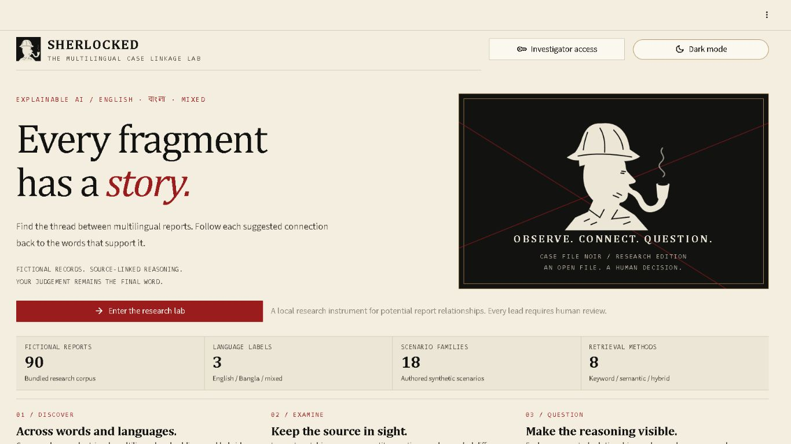

# Landing correction — no working preview
13 November 2026.

Removed the complete live-report preview from the landing page: language/source selectors, sample report cards, computed TF-IDF leads, source handoff and preview-only CSS. The landing no longer imports or calls the retrieval engine. It retains the Sherlock identity, static corpus inventory, capability overview, sign-in entry and light/dark control. The existing authenticated research screens keep their report-processing features.

All **91 tests passed** after this change. The updated entry test confirms there are no public report selectors or text areas and no retrieval-engine call before login. Authentication, appearance continuity and the seven-screen workflow still pass.

The actual running app was reloaded and inspected in the browser. Its full page content contains the hero, corpus inventory, static capability overview and footer; the live preview is absent. The theme switch still changes appearance. An import error during hot reload cleared on reload; the final page rendered normally.

Current source package: `dist/CASE-FILE-NOIR-20261113/no-preview/SHERLOCKED-PORTABLE.zip`. The unchanged model archive remains `dist/CASE-FILE-NOIR-20261113/final/SHERLOCKED-MODEL-ASSETS.zip`. Earlier archives and screenshots are historical.
