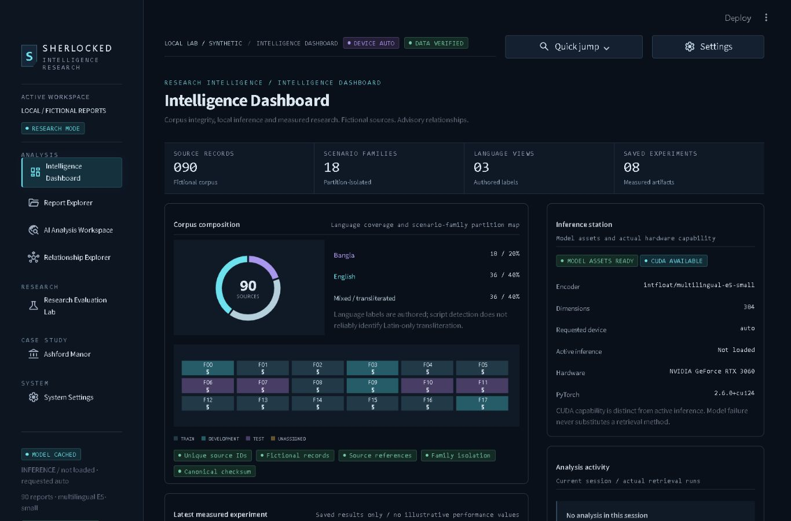
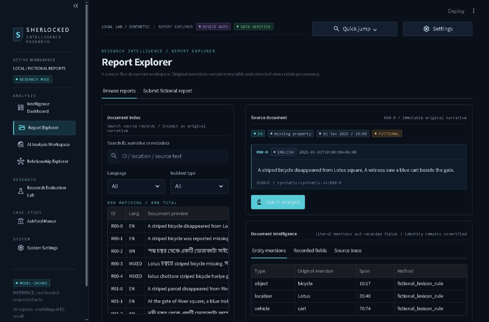
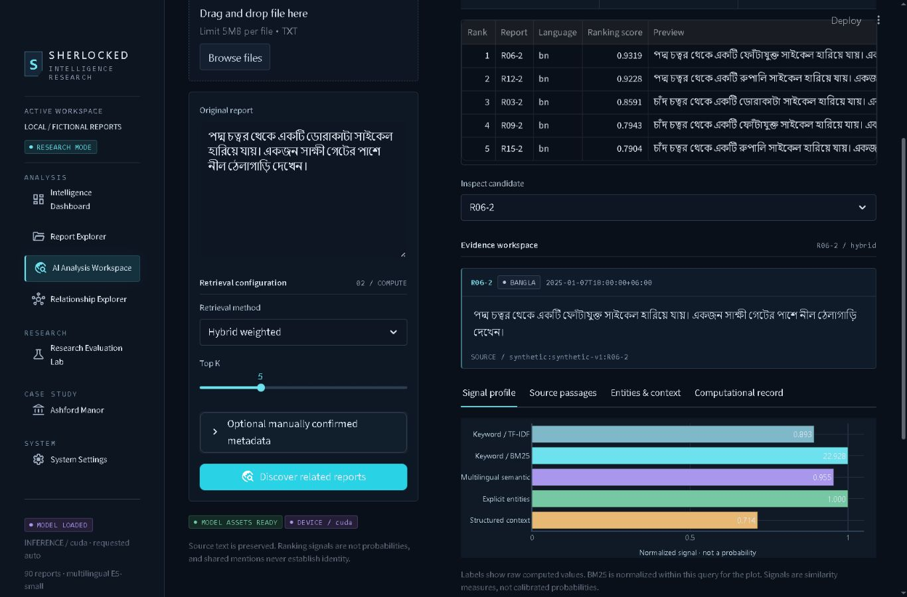
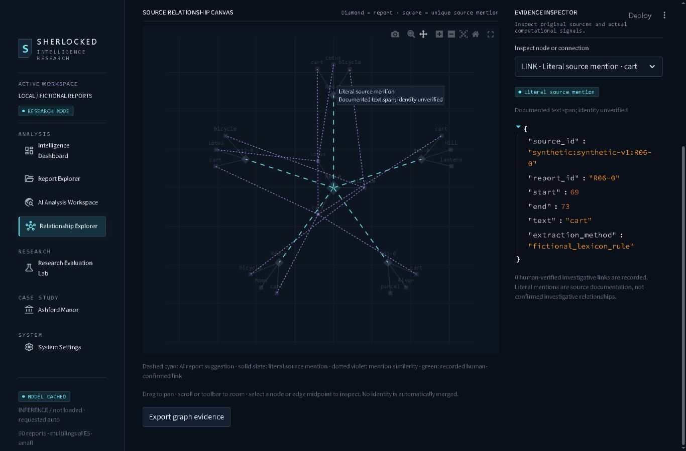
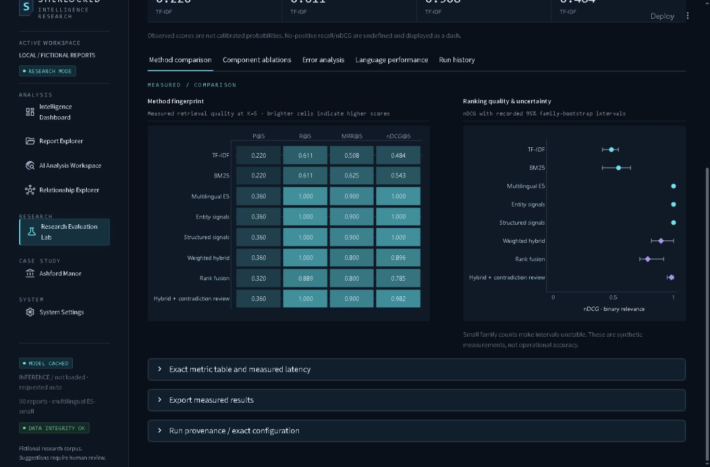
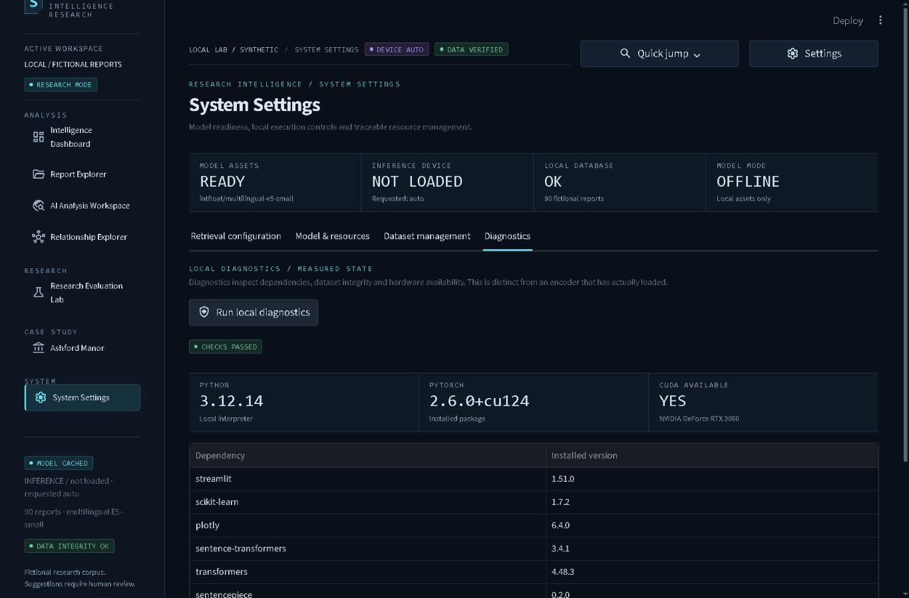
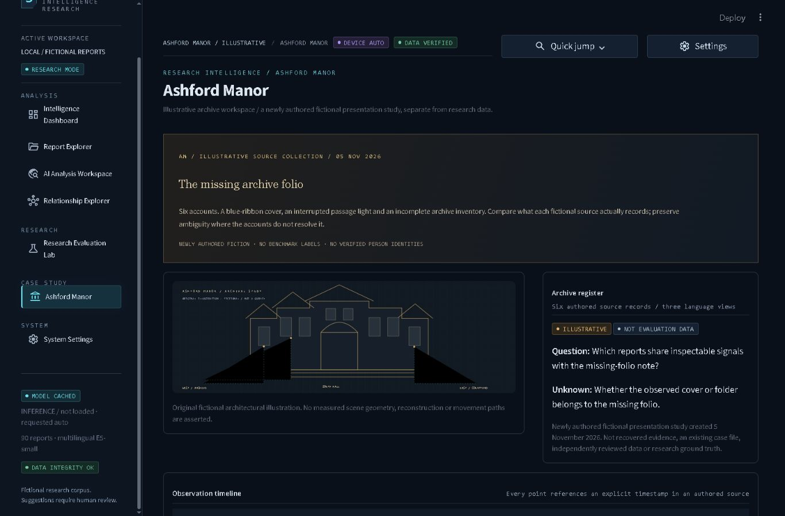
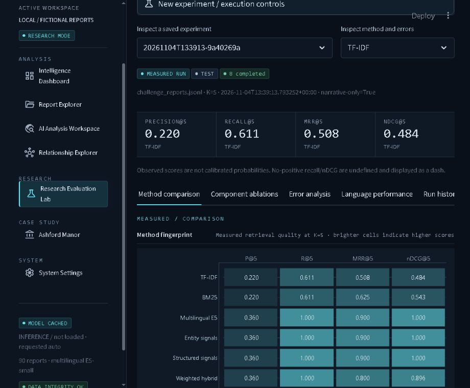

# Interface redesign verification

5 November 2026, Windows 10, Python 3.12.14. This report describes checks actually performed for the visual redesign. Earlier Phase 2 measurements remain historical and were not recomputed or tuned.

## Automated checks

- Full `python -m unittest discover -s tests -v`: **66 passed**. The final run includes seven-screen navigation, English/Bangla/mixed lexical searches, graph retrieval/inspection, real six-report Ashford retrieval, source filtering and fictional submission using an isolated memory store, graph evidence/verification rules, missing/failed research metrics, and portable distribution assets.
- `python -m pip check`: **No broken requirements found.** No new dependency was installed for the redesign.
- Launch through `start.ps1 -NoBrowser -Port 8502`: passed dependency/resource/model checks, canonical manifest validation and HTTP readiness. The preview is `http://127.0.0.1:8502/`. Port 8501 was already occupied by the earlier preview, so a fresh process on 8502 was used for integrated review. Normal launcher default remains 8501.
- Preservation manifest: **32 of 32 SHA-256 hashes unchanged**, including SQLite, both source corpora/qrels/manifests, seven retrieval/storage/configuration backend modules and all preexisting result artifacts. The manifest is `backups/visual-redesign-preservation.json`; the source backup is `backups/visual-redesign-before-20261105.zip`.
- Existing tests still cover idempotent initialization, family split isolation, immutable imports, semantic failure behavior, CPU/CUDA selection, model/cache identity and changed-directory portability. These unit checks do not constitute a new clean-computer dependency installation.

Bare-mode Streamlit cache/context warnings in unittest output are expected. The suite completed without failures or application exceptions.

## Browser review

The actual local app was inspected in the ChatGPT browser, using 1366 x 900 and 920 px wide laptop views. Review covered alignment, dark surfaces, source typography, chart labels, navigation, empty states and controls. At 920 px the research chart columns now stack; the document/main widths remain 920/662 px with no horizontal page overflow. Larger result tables retain their own native scrolling.

| Workspace | Observed result |
|---|---|
| Dashboard | Actual 90 sources, 18 families, 3 language views, 8 historical experiments; actual language/partition plots and model/GPU availability. No session activity is invented. Quick jump returned successfully to dashboard. |
| Report Explorer | Search for R00-2 reduced the index to one source; Bangla filter displayed 18 sources. Original Bangla narrative and exact source ID were preserved. Use in analysis selected R00-2. |
| AI Analysis | Weighted hybrid on Bangla R00-2 returned five candidates. Leading R06-2 score approximately 0.9319, shown as an unverified ranking signal. Actual CUDA inference was visible after completion. Source passages showed exact original highlights and semantic sentence alignment cosine approximately 0.9502 with source offsets. This is a workflow smoke check, not a new benchmark claim. |
| Relationship Explorer | Built six report nodes, five TF-IDF suggestion edges and eighteen literal source mentions. Zero human-verified links. Clicking a graph element selected a real R06-0 cart source-span edge in the inspector. Native zoom/pan controls, layer/search controls and typed source nodes were inspected. |
| Research Lab | Displayed existing measured method comparison/intervals; checked empty ablation state, error ledger, language slices and configuration history. Incompatible run comparisons displayed a protocol warning. No new experiment was run to improve displayed scores. |
| System Settings | Configuration forms rendered; Run local diagnostics reported checks passed, Python 3.12.14, Torch 2.6.0+cu124 and RTX 3060 CUDA availability. Availability remains distinct from active encoder inference. |
| Ashford Manor | Original schematic illustration and six-source register rendered. Timeline points reference authored timestamps. TF-IDF archive analysis actually produced four advisory suggestions and inspectable source evidence. The fixture stayed separate from DB and benchmarks. |

Visual QA fixed toolbar word wrapping on narrow widths, reduced sidebar spacing, brought graph filters into an expandable control, compacted research selectors/exports and stacked narrow-screen scientific charts. Viewport overrides were reset after review. The local preview tab was retained.

## Screenshots from the running application

These are actual browser captures, not generated mockups. All seven screens are included. The evidence, graph and scientific views are scrolled to their main content.

### Intelligence Dashboard

### Report Explorer

### AI Analysis Workspace

### Relationship Intelligence

### Research Evaluation Lab

### System Settings

### Ashford Manor

### Narrow-screen research check

## Remaining limits

Streamlit reruns and native forms remain part of the experience. The graph supports inspection and filtering; there is no persisted analyst verification editor or identity merge operation. Ashford is a small presentation case, not a reconstruction engine or benchmark. This redesign adds neither authentication nor production security/operations controls. No new independent human study, accessibility audit or real-investigation validation was performed. The visual work does not change the documented synthetic-data and heuristic-model limitations.
